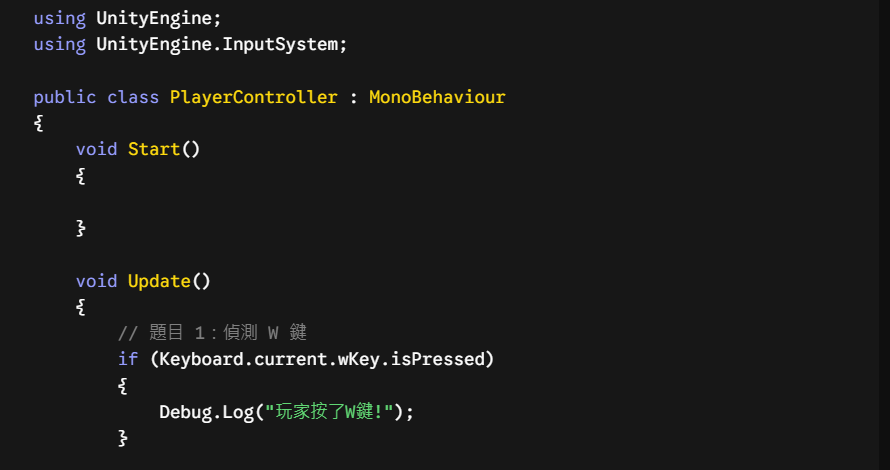
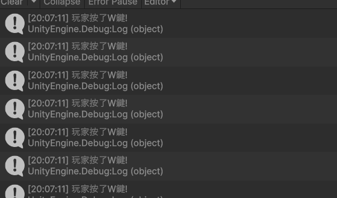
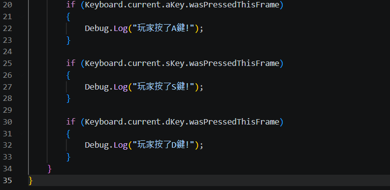
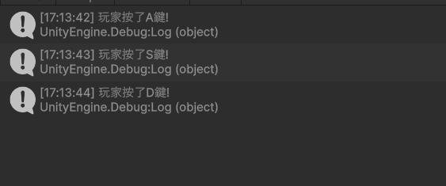

# 第2次練習題目-隨堂-QZ2
>
>學號：113111132
><br />
>姓名：曹翔凱
><br />
>作業撰寫時間：150 mins
><br />
>最後撰寫文件日期：2026/10/24
>

本份文件包含以下主題：(至少需下面兩項，若是有多者可以自行新增)
- [x] 說明內容
- [x] 其他 (可以包含心得或是想跟老師反映)

## 說明內容

開始寫說明，該說明需說明想法，
並於之後再對上述想法的每一部分將程式進一步進行展現，
若需引用程式區則使用下面方法，
若為.cs檔內程式除了於敘述中需註明檔案名稱外，
還需使用語法` ```語言種類 程式碼 ``` `，其中語言種類若是要用python則使用py，java則使用java，C/C++則使用cpp，
下段程式碼為語言種類選擇csharp使用後結果：

```csharp
public void mt_getResult(){
    ...
}
```

若要於內文中標示部分網頁檔，則使用以下標籤` ```html 程式碼 ``` `，
下段程式碼則為使用後結果：

```html
<%@ Page Language="C#" AutoEventWireup="true" ...>

<!DOCTYPE html>

<html xmlns="http://www.w3.org/1999/xhtml">
<head runat="server">
<meta http-equiv="Content-Type" ...>
    <title></title>
</head>
<body>
    <form id="form1" runat="server">
        <div>
        </div>
    </form>
</body>
</html>
```
更多markdown方法可參閱[https://ithelp.ithome.com.tw/articles/10203758](https://ithelp.ithome.com.tw/articles/10203758)

請在撰寫"說明程式與內容"該塊內容，請把原該塊內上述敘述刪除，該塊上述內容只是用來指引該怎麼撰寫內容。

1. (需截圖說明，並且需截圖執行結果)

Ans:



第 1 列 using UnityEngine;

引入 Unity 核心引擎命名空間，啟用 Unity 內建的基本功能。

第 2 列 using UnityEngine.InputSystem;

引入新版輸入系統工具箱，使程式能夠識別鍵盤與按鍵。

第 4～5 列 public class PlayerController : MonoBehaviour {

宣告與 C# 檔名相同的公開類別，並繼承 MonoBehaviour 以便掛載至場景物件上。

第 6～9 列 void Start() { }

遊戲啟動時執行一次的初始化函式（本題無須初始化故留空）。

第 11～12 列 void Update() {

遊戲執行期間每個影格自動重複執行的函式，用於即時偵測按鍵。

第 13 列 // 題目 1：偵測 W 鍵

單行註解，用來說明程式用途，不影響執行。

第 14 列 if (Keyboard.current.wKey.isPressed)

條件判斷式：當鍵盤 (Keyboard.current) 的 W 鍵 (wKey) 處於被按住狀態 (.isPressed) 時，執行下方動作。

第 15、17 列 { 與 }

標示條件成立時執行的程式碼區塊範圍。

第 16 列 Debug.Log("玩家按了W鍵!");

當偵測到 W 鍵被按下時，於 Unity 主控台（Console）即時印出指定訊息。
2. (需截圖說明，並且需截圖執行結果)

Ans:



第 20 列 if (Keyboard.current.aKey.wasPressedThisFrame)

條件判斷式：當鍵盤 (Keyboard.current) 的 A 鍵 (aKey) 在當前影格被按下 (.wasPressedThisFrame) 時，執行下方動作。

第 21 列 {

標示條件成立時要執行的程式碼區塊範圍開始。

第 22 列 Debug.Log("玩家按了A鍵!");

當 A 鍵被按下時，於 Unity 主控台（Console）即時印出指定訊息。

第 23 列 }

標示條件成立時要執行的程式碼區塊範圍結束。

第 24 列 （空白列）

排版留白，用於區隔不同的按鍵偵測邏輯。

第 25 列 if (Keyboard.current.sKey.wasPressedThisFrame)

條件判斷式：當鍵盤的 S 鍵 (sKey) 在當前影格被按下時，執行下方動作。

第 26 列 {

標示條件成立時要執行的程式碼區塊範圍開始。

第 27 列 Debug.Log("玩家按了S鍵!");

當 S 鍵被按下時，於 Unity 主控台（Console）即時印出指定訊息。

第 28 列 }

標示條件成立時要執行的程式碼區塊範圍結束。

第 29 列 （空白列）

排版留白，區隔 S 鍵與 D 鍵的程式段落。

第 30 列 if (Keyboard.current.dKey.wasPressedThisFrame)

條件判斷式：當鍵盤的 D 鍵 (dKey) 在當前影格被按下時，執行下方動作。

第 31 列 {

標示條件成立時要執行的程式碼區塊範圍開始。

第 32 列 Debug.Log("玩家按了D鍵!");

當 D 鍵被按下時，於 Unity 主控台（Console）即時印出指定訊息。

第 33 列 }

標示條件成立時要執行的程式碼區塊範圍結束。

第 34 列 }

標示 Update() 函式程式碼區塊的結束。

第 35 列 }

標示 PlayerController 類別程式碼區塊的結束。
## 其他
在Unity新增腳本過程中遇到了不少狀況,像是腳本掛載到錯誤的物件無法出現訊息,透過反覆排錯與修正我學會掛載方式,雖然除錯花了不少時間，但解決後讓我對 Unity 的操作邏輯與腳本運作有了更進一步的理解。